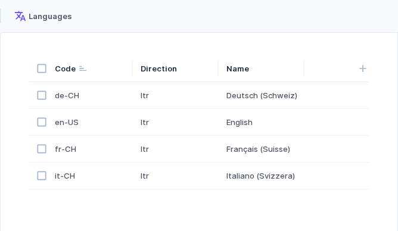
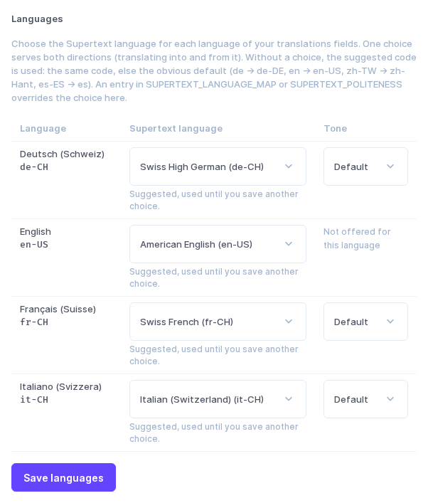
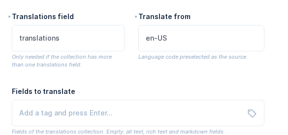
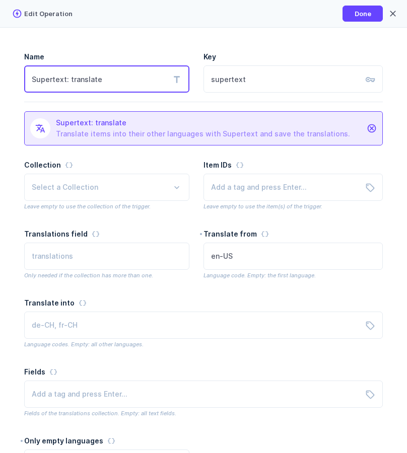

# Installation guide

For administrators who set up a Directus project. Editors: see the [User guide](USER_GUIDE.md).

## Requirements

| | |
| --- | --- |
| Directus | 12 (tested with 12.6) |
| Node.js | 22 or newer, as required by Directus 12 (Directus 12.6 and later need Node.js 26 or newer) |
| Database | Any database Directus supports (tested with PostgreSQL and SQLite) |
| Multilingual content | Directus's standard setup: a languages collection and a **Translations** field on each collection to translate (see [Language setup](#language-setup)) |
| Supertext | A Supertext account and an API key with access to AI translation (see [Supertext account and API key](#supertext-account-and-api-key)) |

The Directus server must reach `https://api.supertext.com` over HTTPS (and, for [Translation review](#translation-review), Supertext's review service).

## Install

The extension is a Directus *bundle* (an endpoint, an interface and a Flow operation). It runs on the Directus server, so it can't be sandboxed.

**From npm** (once published): in your Directus project, `npm install directus-extension-supertext-translation` and restart Directus. In the Marketplace (*Settings → Marketplace*), non-sandboxed extensions only show up with `MARKETPLACE_TRUST=all`.

**From this repository** (until it is on npm):

```bash
git clone https://github.com/Supertext/Directus-Supertext-Translation.git
cd Directus-Supertext-Translation
npm ci && npm run build
mkdir -p <your-project>/extensions/directus-extension-supertext-translation
cp -r package.json dist <your-project>/extensions/directus-extension-supertext-translation/
```

**Docker** (official `directus/directus` image): copy `package.json` and `dist/` to `/directus/extensions/directus-extension-supertext-translation/` in your image, as [demo/Dockerfile](../demo/Dockerfile) does.

Restart Directus. The log shows `Loaded extensions: … directus-extension-supertext-translation`.

## API key and settings

### Supertext account and API key

1. No Supertext account yet? Create one (or log in) at <https://www.supertext.com/person/en/account/signin>: enter your e-mail address and follow the link Supertext sends you.
2. Generate your API key at *supertext.com → Integrations → API*: <https://www.supertext.com/en/integrations/api>. This requires the **Admin** role in your Supertext account; otherwise ask a Supertext admin of your company.
3. Set the key as `SUPERTEXT_API_KEY` (below) and restart Directus. The Supertext page shows both links too, and *Test connection* checks the key.

### Settings

Settings are environment variables of the Directus server (`.env` or container variables). Never commit the key.

| Variable | Default | Description |
| --- | --- | --- |
| `SUPERTEXT_API_KEY` | — | Supertext API key. Pasting it with the `Supertext-Auth-Key ` prefix works too. Without a key the translate box says so and the button is disabled. |
| `SUPERTEXT_ENVIRONMENT` | `live` | `live`, `staging` or `testing` Supertext API. |
| `SUPERTEXT_API_URL` | — | Explicit API base URL; overrides `SUPERTEXT_ENVIRONMENT`. For [Translation review](#translation-review) use the checkbox per language on the Supertext page instead. |
| `SUPERTEXT_REVIEW_URL` | Supertext's review service | Address of the review service for languages with *Translation review* on. Empty (`SUPERTEXT_REVIEW_URL=`) turns review off for every language. Only change it when Supertext gives you another address. |
| `SUPERTEXT_LANGUAGE_MAP` | `{}` | Optional, for automated setups. JSON: Directus language code → Supertext code, e.g. `{"de":"de-CH","zh-CN":"zh-Hans"}`. Normally you choose the codes on the Supertext page instead (see [Language setup](#language-setup)); an entry here wins over that choice for its language, and the page shows it as *Set by SUPERTEXT_LANGUAGE_MAP*. |
| `SUPERTEXT_POLITENESS` | `{}` | Optional, for automated setups. JSON: language → `more` (formal) or `less` (informal), e.g. `{"de-CH":"more"}`. Wins over the tone chosen on the Supertext page. |
| `SUPERTEXT_CONCURRENCY` | `3` | Languages translated at the same time. |
| `SUPERTEXT_POLL_INTERVAL` | `2` | Seconds between status checks while Supertext translates. |
| `SUPERTEXT_TIMEOUT` | `180` | Maximum seconds to wait for one language. |
| `SUPERTEXT_VERSION_REPORTS` | on | *Send version information to Supertext* (see below). `0` (or `false`, `off`, `no`) turns it off. |

JSON values can be written as they are, commas included (Directus would normally split a value at its commas; the extension reads these variables unsplit).

### Version information and the API key check

**Send version information to Supertext** is on by default. The extension then sends the site URL and the versions of this extension, Directus and Node.js to Supertext after an update and when the API key changes, so Supertext support can see which version you run. A report contains exactly: the site URL (`PUBLIC_URL`, else the address the request came in on), the extension's name and version, the Directus and Node.js versions, the Supertext SDK version, whether a key is set, the result of the API key check below (status, time, HTTP status, Supertext's error code) and the address of the ping endpoint. **No content, no API key and no personal data are sent.** Reports go from the Directus server, never from the browser; a report that fails is not retried for an hour and never slows down or breaks a translation. Set `SUPERTEXT_VERSION_REPORTS=0` and restart Directus to turn it off: nothing is sent at all then, and the ping endpoint answers 404.

**The API key check** runs whether or not version information is sent: when Directus first runs the extension's code with a key it hasn't checked yet (the key in `SUPERTEXT_API_KEY` is compared by a fingerprint kept in the database, never the key itself), on **Test connection**, and when Supertext rejects the key during a translation. It's Supertext's cost-free `features` call; nothing is translated or billed. The Supertext page shows the latest result with its time: *the connection works*, *Supertext rejected the API key* (with the links to create an account and generate a key), *no API key is set*, *Supertext can't be reached* or *Supertext answered with an error*.

**The ping endpoint** `GET <PUBLIC_URL>/supertext/ping?challenge=…` is public (no login) and answers only `{"ok":true,"plugin":"Directus-Supertext-Translation","challenge":"…"}`, so Supertext can see that the site is reachable from the internet. It returns nothing else: no versions, no settings, no data.

The extension keeps its state (what was reported last, the latest key check, the languages chosen on the Supertext page) in a small table `supertext_state` that it creates in the Directus database on first use. Directus lists it as an unmanaged table in the data model; don't add it as a collection.

### The Supertext page

The bundle adds a **Supertext** page for administrators: the installed plugin version (linked to its release notes on GitHub), whether a key is set (with links to create a Supertext account and generate the key), which API is used, the review service for [Translation review](#translation-review), how many languages run at a time, the timeout, the latest API key check and a **Test connection** button (a cost-free call to the Supertext API that checks the key again), whether version information is sent to Supertext, and every language of your translations fields with a combo box for its Supertext language, its tone and the *Translation review* checkbox (see [Language setup](#language-setup)).

Directus hides new modules until they're switched on: *Settings → Settings → Module Bar*, enable **Supertext**. Only administrators see it.


### Interface languages

The translate box, the Supertext page, the Flow operation and their messages are available in English, German, French and Italian and follow each user's Directus language (*User Directory* → the user → *Language*, or the project default under *Settings* → *Settings* → *Default Language*). Regional variants use their language (e.g. *Français (Canada)* gets French); other languages show English. Directus has no way for extensions to register their own translation strings, so the plugin brings its own; nothing needs to be added under *Settings* → *Translations*. The interface language is independent of the content languages below.

## Language setup

The plugin uses Directus's own translations model. If your collections are already translated with a **Translations** field, there is nothing to change.

1. A **languages collection** (*Settings → Data Model*, usually `languages`) with the language code as primary key (`en-US`, `de-CH`, `fr-CH`, …) and a name.
2. On each collection to translate, a field of type **Translations** that points to it. Directus creates the `<collection>_translations` collection; the translatable fields (title, text, …) live there.
3. In the Translations field's options, set the *Default Language* to the language you write in. It is preselected as the source.



Each Directus language needs a Supertext language. Supertext accepts exactly these target codes (from its `features` list, October 2026):

| Language | Supertext codes |
| --- | --- |
| German, English, French, Italian, Portuguese | `de-DE`, `de-CH`, `de-AT`, `en-US`, `en-GB`, `fr-FR`, `fr-CH`, `it-IT`, `it-CH`, `pt-PT`, `pt-BR` |
| Chinese, Serbian | `zh-Hans`, `zh-Hant`, `sr-Latn`, `sr-Cyrl` |
| Swiss German | `gsw-u-sd-chzh` (Zurich), `gsw-u-sd-chbe` (Bern) |
| All others, without region | `bg`, `cs`, `da`, `el`, `es`, `fi`, `hr`, `hu`, `ja`, `ko`, `nb`, `nl`, `pl`, `rm`, `ru`, `sk`, `sl`, `sq`, `sv`, `tr` |

**Choose the Supertext language on the Supertext page** (module bar → **Supertext** → *Languages*, administrators only): one row per Directus language, source language included, with a combo box listing Supertext's codes as *Name (code)* (names in your interface language), where Supertext offers it a *Tone* box (*Default*, *Formal*, *Informal*), and a *Translation review* checkbox (off by default, see [Translation review](#translation-review)). Click **Save languages**; the choices are stored in the Directus database (table `supertext_state`) and apply right away, without a restart. One choice serves both directions: with German → `de-CH`, German is translated into `de-CH` and from `de` (the source language is always sent without region).

Each combo box starts with the saved choice, else the suggestion, else *— choose —*:

| Directus code | Suggested (and used until you save another choice) |
| --- | --- |
| A Supertext code, apart from upper/lower case and `_`/`-` | That code: `de-CH`, `fr_ch` → `fr-CH`, `es`, `zh-hant` → `zh-Hant` |
| `de`, `en`, `fr`, `it`, `pt` | `de-DE`, `en-US`, `fr-FR`, `it-IT`, `pt-PT` |
| `zh`, `zh-CN`, `zh-SG` / `zh-TW`, `zh-HK`, `zh-MO` | `zh-Hans` / `zh-Hant` |
| `sr`, `sr-Latn-RS` / `sr-Cyrl-RS` | `sr-Latn` / `sr-Cyrl` |
| A region of a language Supertext offers without region | The bare code: `es-ES`, `es-419` → `es`, `nl-NL` → `nl`, `nb-NO` → `nb` |
| Anything else, e.g. `en-IE`, `de-LI`, `fr-BE`, `gsw`, `sr-RS`, `no` | None: the combo box shows *— choose —* and the row says *No default*. Until you choose one, the language is reported as *has no Supertext language yet* and nothing is sent for it. |

- Formal/informal is only offered where Supertext has it; English, Swiss German, Romansh, Albanian and Serbian have no *Tone* box.
- **Override for automated setups:** an entry in `SUPERTEXT_LANGUAGE_MAP` (or `SUPERTEXT_POLITENESS`) wins over the choice on the page for that language. The page then shows the combo box disabled with *Set by SUPERTEXT_LANGUAGE_MAP: …*. Remove the entry and restart Directus to choose on the page again. Mappings already set in these variables keep working unchanged after an update; nothing needs to be moved.



## Translation review

With **Translation review**, people check the translations on the website itself and correct them there: customers or Supertext linguists open the original and the translated page side by side in Chrome with the *Supertext Localization Review* extension and fix texts in a side panel. Their corrections come back into Directus.

Turn it on per language that is translated **into**: module bar → **Supertext** → *Languages* → tick **Translation review** in the language's row → **Save languages** (administrators only). Untick it to turn it off again; nothing else changes. The choice is stored with the language mapping in `supertext_state`; after an update every language starts with review off.

- Translations into that language then go through Supertext's review service instead of directly to Supertext. It answers exactly like Supertext and passes everything on with your API key, so billing, languages, formal/informal and error messages stay the same. Other languages keep going directly to Supertext. This applies to the *Translate with Supertext* box and the Flow operation alike.
- The review service keeps every translation of your account. A text it has translated before gets the same translation again (without a new Supertext call), and once a reviewer has corrected it, the corrected text.
- **Corrections arrive with the next translation:** after a review, translate the items again (*Translate with Supertext*, or the Flow) to bring the corrections into Directus. As always, translating again replaces manual changes in the translated fields.
- Reviewers get a review link for your site from Supertext; nothing to set up in Directus.
- The review service works with keys of the **live** Supertext API. With `SUPERTEXT_ENVIRONMENT=staging` or `testing`, leave review off.
- *Export for translation* and *Import translation* don't use the review service. The API key check (*Test connection*, the automatic check) still goes directly to Supertext.
- The Supertext page shows the review service's address under *Review service*, or *Off* when `SUPERTEXT_REVIEW_URL` is empty (then the checkboxes are disabled).

## Add the translate box to a collection

1. *Settings → Data Model →* your collection → **Create Field** → **Supertext translation** (in the *Presentation* group).
2. Options (all optional):
   - **Translations field**: only needed if the collection has more than one translations field.
   - **Translate from**: the source language code to preselect (default: the Translations field's default language).
   - **Fields to translate**: fields of the translations collection; empty = all text, rich text and markdown fields.
3. Save and drag the field above the Translations field.



### What is translated

Fields of the `<collection>_translations` collection, chosen by their interface:

| Interface | Treatment |
| --- | --- |
| Input, Textarea (`input`, `input-multiline`) | Plain text |
| WYSIWYG (`input-rich-text-html`) | Rich text, block by block; formatting, links and structure kept |
| Markdown (`input-rich-text-md`) | Text of headings, paragraphs, list items, quotes and table cells; markdown syntax, links and code kept |

Not translated: slugs (inputs with the *slug* option), hidden and read-only fields, dropdowns, JSON, block editor, code, files and relations.

## Permissions

The plugin acts with the signed-in user's permissions:

- To translate, a user must be allowed to **update the item**, and to read the languages and translations collections.
- Saving the translations (the editor clicks *Save*) needs create/update permission on the translations collection, as for typing them by hand.
- Administrators can always translate.

*Export for translation* and *Import translation* (in the same box) need the same permission as translating: update the item. They need no API key and nothing to configure. Uploaded files are limited to **10 MB** (checked before reading, independent of `MAX_PAYLOAD_SIZE`), parsed in memory and never stored; imported translations go into the form and are saved by the editor, like translations. A reverse proxy in front of Directus must allow 10 MB request bodies for `POST /supertext/import`.

No extra permission setting is needed. Users who may only read never spend translation credit: the request is refused before anything is sent to Supertext.

## Flows: automation and bulk translation

The bundle adds the Flow operation **Supertext: translate**. It translates and **saves**.



| Option | Description |
| --- | --- |
| Collection, Item IDs | Empty: taken from the trigger (event `key`/`keys`, manual trigger `keys`). |
| Translations field | Only needed if the collection has more than one. |
| Translate from | Source language code. Empty: the Translations field's default language. |
| Translate into | Language codes. Empty: all other languages. |
| Fields | Empty: all translatable fields. |
| Only empty languages | Skip languages that already have text. |

Examples:

- **Bulk from the item list:** Flow with a *Manual* trigger on the collection (location: collection/both), then the operation. Select items in the list and run the flow from the sidebar.
- **Translate new items automatically:** *Event Hook* trigger, type *Action*, scope `items.create`, the collection; operation with *Only empty languages*. Saving from the operation does not trigger flows again, so there is no loop.

The flow runs with its own permissions (*Run with: All permissions*, or the triggering user). If a language fails, the operation still saves the others and then fails with the details (reject path, flow logs).

## Update

npm: `npm update directus-extension-supertext-translation`; from the repository: pull, `npm ci && npm run build`, copy `dist/` again. Restart Directus. See [CHANGELOG.md](../CHANGELOG.md).

## Uninstall

Delete the *Supertext translation* fields from your collections and any flows using the operation, remove *Supertext* from the module bar, then remove the extension folder (or `npm uninstall`) and restart. Translations stay as they are. The plugin's own data (the languages chosen on the Supertext page and the version report state) is the table `supertext_state`; drop it if you don't reinstall.

## Troubleshooting

| Symptom | Cause / fix |
| --- | --- |
| No *Supertext translation* interface when creating a field | The extension isn't loaded: check the Directus log for `Loaded extensions` / `Couldn't register bundle`, and that `dist/` was copied. |
| "No Supertext API key is configured" | Set `SUPERTEXT_API_KEY` and restart Directus. No key yet: see [Supertext account and API key](#supertext-account-and-api-key). *Test connection* on the Supertext page checks it. |
| No *Supertext* page in the module bar | Enable it under *Settings → Settings → Module Bar* (administrators only). |
| A JSON setting has no effect | Check it on the Supertext page (language table: *Set by SUPERTEXT_LANGUAGE_MAP*). The value must be a JSON object, e.g. `{"de-CH":"more","fr-CH":"more"}`. |
| A language's combo box is disabled | `SUPERTEXT_LANGUAGE_MAP` (or `SUPERTEXT_POLITENESS` for the tone) sets it; remove the entry and restart Directus to choose on the page. |
| "Save the item first, then translate it" | New items need to be saved once. |
| "There is no en-US text to translate" | The source language has no saved text; fill in and save it, or pick another source. |
| "You are not allowed to edit this item." | The user lacks update permission on the item (see [Permissions](#permissions)). |
| "Supertext rejected the API key" on the Supertext page | The key is wrong or revoked. Check that the whole key was copied into `SUPERTEXT_API_KEY`, or generate a new one at <https://www.supertext.com/en/integrations/api> (Admin role required). No Supertext account yet? Create one at <https://www.supertext.com/person/en/account/signin>. Restart Directus, then *Test connection*. |
| "The API key couldn't be checked because Supertext can't be reached" | The Directus server can't reach `api.supertext.com` (firewall, proxy, DNS). Translations need the same connection. |
| "Authentication failure" only for languages with *Translation review* | The review service only works with keys of the live Supertext API: with `SUPERTEXT_ENVIRONMENT=staging`/`testing` (or `SUPERTEXT_API_URL`) leave review off. |
| Reviewers' corrections don't show up in Directus | They arrive with the next translation: translate the items into that language again. Check that the language's *Translation review* is ticked on the Supertext page. |
| "Authentication failure" | Wrong key, or a key for another environment (`live` vs `staging`). Generate a new one at <https://www.supertext.com/en/integrations/api> (Admin role required). |
| "Too many requests to Supertext" | Rate limit; requests are retried automatically. Lower `SUPERTEXT_CONCURRENCY` if it persists. |
| "Your Supertext translation limit is exceeded" | The Supertext subscription quota is used up. |
| "The language … has no Supertext language yet" / *No default* on the Supertext page | The Directus code has no obvious Supertext code (e.g. `en-IE`, `gsw`): choose one in its combo box on the Supertext page and click *Save languages* (see [Language setup](#language-setup)). |
| "Supertext does not support this language pair" | A code in `SUPERTEXT_LANGUAGE_MAP` that Supertext doesn't offer (e.g. `es-ES` instead of `es`), or the same language as the source; fix the entry, or remove it and choose on the Supertext page. The details show the codes that were sent. |
| "Supertext offers no formal or informal tone for this language" | `SUPERTEXT_POLITENESS` sets `more`/`less` for a target without it (English, Swiss German, Romansh, Albanian, Serbian); remove that entry. |
| "Timed out waiting…" | Very long content or slow service: raise `SUPERTEXT_TIMEOUT`. |
| Rich text opens read-only after saving ("formatting the new editor doesn't support") | The **source** HTML already wasn't in the editor's form (e.g. imported content). Open the source field once, let Directus convert it, save, and translate again. |

Errors are also written to the Directus log (`[supertext] …`).
