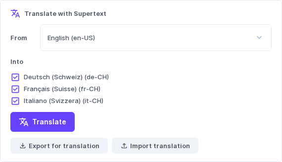
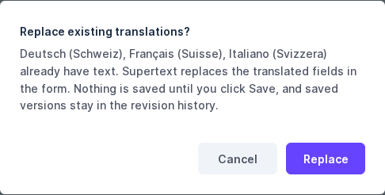
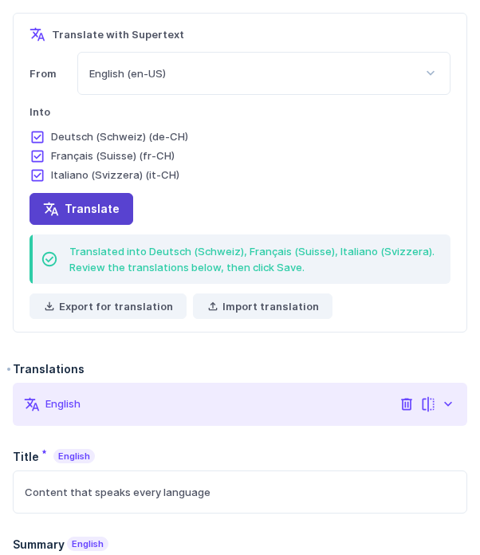
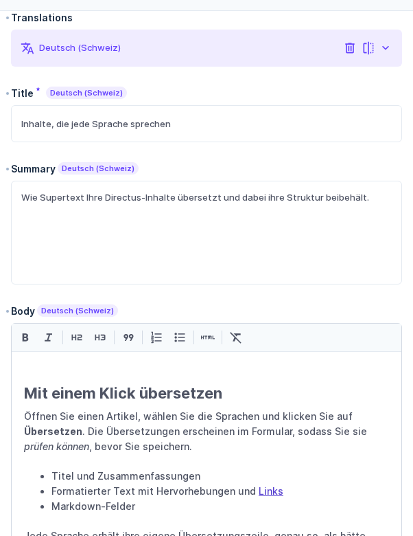
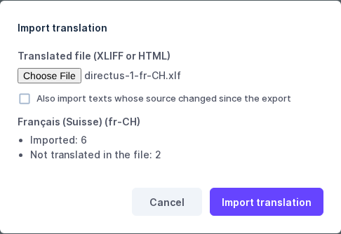

# User guide

For editors working in the Directus app. The Supertext box and its messages follow your Directus language (English, German, French or Italian; change it in your user profile under *Language*).

In Directus, each item has one **translation per language** in its *Translations* field. Supertext translates the text of one language into the others and fills them into the form. You review the result and save it, as if you had typed it.

## Translate an item

1. Open the item (e.g. *Content → Articles →* an article). It must have been saved at least once.
2. In the **Translate with Supertext** box:
   - **From**: the language you translate from (usually preselected).
   - **Into**: tick the languages to translate into. *has text — will be replaced* marks languages that already have a translation.

   

3. Click **Translate** and wait a few seconds per language.
4. If a selected language already has text, Directus asks before replacing it:

   

5. The box confirms which languages were translated. The *Translations* field now has unsaved changes (dot next to its label).

   

## Review and save

- Switch the language in the *Translations* field to check each translation. Edit anything you like.

  

- Click **Save** to store the translations. Until then nothing is changed; *Cancel* or leaving the page discards them.
- After saving, the previous version stays in the item's *Revisions*.

## Translate with a file (XLIFF or HTML)

Below *Translate*, the box has **Export for translation** and **Import translation**: download the item's text as a file, have it translated anywhere (a translation tool, a translator, Supertext's web app) and bring it back into the form. The file contains exactly the text *Translate* would send, from the saved **From** language.

### Export for translation

1. Open the saved item, choose the **From** language and click **Export for translation**.
2. Choose the **File format**:
   - **XLIFF 1.2 (for translation tools)**: the standard format of Trados, memoQ, Phrase and other translation tools, and the better choice for them. Formatting (bold, links …) appears as protected tags. One file can hold several target languages.
   - **HTML (one language per file)**: for Supertext's web app or anyone who translates HTML.
3. Choose the **Target languages** and click **Download file** (`directus-<item id>-<language>.xlf`, or `directus-<item id>.xlf` for several languages).

If the source language has no text, the dialog says *Nothing to translate.* Whoever translates an **HTML** file must leave its head (the `supertext:` lines) and the `data-st-id` attributes alone. An HTML file can't mark text as untranslated: imported unchanged, it puts the source text into the target language.

### Import translation

1. Open the same item and click **Import translation**.
2. Choose the **Translated file (XLIFF or HTML)** (at most 10 MB). Tick **Also import texts whose source changed since the export** to take translations of texts edited after the export too (skipped by default).
3. Click **Import translation**. The dialog shows a summary per language; if a language already has text, Directus asks before replacing it, as for *Translate*.
4. The translations are now in the form, like after *Translate*: review them in the *Translations* field and click **Save** (nothing is saved before).

| Line | Meaning |
| --- | --- |
| *Imported: n* | Texts put into the form. A field of which only some paragraphs were translated keeps the source text in the others. |
| *Skipped, source changed since the export: n* | The source text was edited after the export. Tick *Also import texts whose source changed since the export*, or export again. |
| *Not translated in the file: n* | The file has no translation for these texts (XLIFF). |
| *Formatting changed, not imported: n* | The translation broke, removed or added formatting the source doesn't have. Fix it in the translation tool. |
| *Not in the file: n* | Text added after the export. Export again to translate it. |

| Message | Meaning |
| --- | --- |
| *This file isn't a valid XLIFF or HTML translation file.* | The file is damaged or not XLIFF/HTML. |
| *This file wasn't exported by the Supertext extension, or its header was removed.* | Use a file from *Export for translation*; for HTML keep its head. |
| *The file is too large (at most 10 MB).* | Export fewer languages per file. |
| *This file belongs to another system (…).* | It comes from another Supertext plugin (another CMS). |
| *This file belongs to another item (…). Import it in that item's form.* | Open the item the file was exported from. |
| *The item this file was exported from no longer exists.* | The file's reference can't be read, or the item is gone. |
| *The project has no language ….* | The file's source or target language isn't in the languages collection (any more). |

## What is translated

- Text fields of the translations (title, summary, …)
- Rich text (WYSIWYG): every paragraph, heading, list item, quote and table cell, with **bold**, *italic* and links kept in place
- Markdown: headings, paragraphs, list items, quotes and table cells; markdown syntax, links and code stay as they are

## What is not translated

- Slugs and other technical fields, dropdowns, dates, numbers
- Files and images, relations to other items
- Block editor and JSON fields
- Code blocks in rich text or markdown

## Things to know

- **Supertext translates the saved text.** If you changed the source language and didn't save, the box asks you to save first.
- **Translating again replaces** the translated fields of the selected languages. Make changes in the source language and translate again, or edit only after the last translation.
- Fields you fill by hand that Supertext doesn't translate (e.g. a slug) are kept.
- **Export and import work without an API key**: nothing is sent to Supertext's API.
- Your administrator may also translate automatically when items are created, or in bulk from the item list (a *Flow*). Those save directly.

## Messages

| Message | Meaning |
| --- | --- |
| *Translated into … Review the translations below, then click Save.* | Done; check and save. |
| *Save the item first, then translate it.* | New items must be saved once. |
| *The … text has unsaved changes.* | Save first: Supertext translates the saved text. |
| *There is no … text to translate.* | The source language is empty; choose another one or fill it in. |
| *Some text kept the source because Supertext returned it empty* | Check the named fields. |
| *No Supertext API key is configured.* | Ask your administrator (setup: [Supertext account and API key](INSTALLATION.md#supertext-account-and-api-key)). |
| *You are not allowed to edit this item.* | You can't translate items you can't edit. |
| *Authentication failure* / *limit is exceeded* | Supertext account problem; ask your administrator. |
| *The language … has no Supertext language yet* | The language has no obvious Supertext language (e.g. Irish English `en-IE`) and your administrator hasn't chosen one yet. Ask them to choose it on the Supertext page (*Languages*); the other languages are translated. |
| *Supertext does not support this language pair* | One of the languages isn't one Supertext translates; ask your administrator to check the language mapping. |
| *Supertext offers no formal or informal tone for this language* | The tone setting for that language isn't available; ask your administrator to set it to *Default* on the Supertext page. |
| *Timed out waiting…* | Try again, or translate fewer languages at once. |

If you don't see the *Translate with Supertext* box, your administrator hasn't added it to this collection yet.
